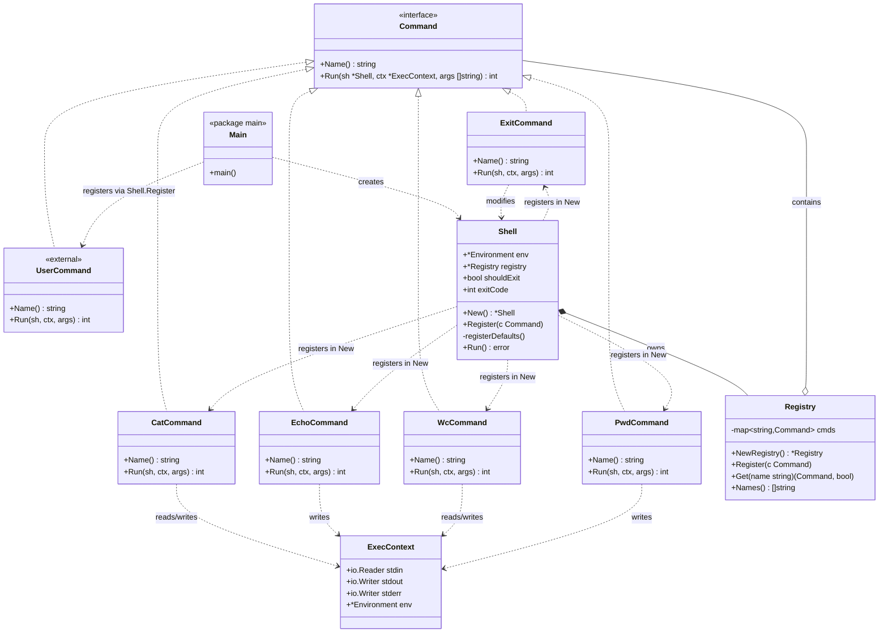

## Command и Registry — финальное описание

### Идея

Все команды регистрируются **явно**. Никаких `init()`, никакого глобального реестра, никакой магии. `Shell` создаёт `Registry`, наполняет его стандартным набором в `New()`, а пользователь добавляет свои команды через публичный метод `Shell.Register`. Всё состояние живёт в экземпляре `Shell`, а не в пакетных переменных.

Это делает систему:
- **предсказуемой** — весь набор команд виден в `New()` и в `main.go`;
- **тестируемой** — каждый тест создаёт свой `Registry`, нет общего состояния;
- **расширяемой** — `sh.Register(&MyCommand{})` в `main` добавляет команду, при совпадении имени перекрывает стандартную.

### Интерфейс `Command`

```go
type Command interface {
    Name() string
    Run(sh *Shell, ctx *ExecContext, args []string) int
}
```

Четыре момента, которые важно понимать:

**`Name()` — имя для регистрации.** Реестр использует его как ключ. Не нужно дублировать строку `"echo"` в двух местах — она живёт в самой команде.

**`args` — уже раскрытые аргументы без имени команды.** Executor вызывает `cmd.Run(sh, ctx, args[1:])`. То есть `cd /tmp` даёт `args = ["/tmp"]`. Это единообразно: builtin получает то же, что получил бы `main` отдельной программы.

**`ctx` — потоки и окружение конкретной команды.** Команда **не** должна писать в `os.Stdout` напрямую — только в `ctx.Stdout`. Это позволяет одной и той же команде работать на терминале, в пайпе и с редиректом без изменения кода.

**`sh` — доступ к глобальному состоянию.** Нужен только командам, меняющим состояние shell: `exit` выставляет `sh.shouldExit`, в будущем `cd` поменяет `PWD`, `export` — окружение. `echo` и `wc` его игнорируют.

### Возвращаемое значение

`int` — код возврата. Это **не** `error`, потому что в shell'е код возврата — часть семантики (`$?`, `&&`, `||`), а не исключительная ситуация. Ошибка «файл не найден» в `cat` — это код 1 плюс сообщение в `ctx.Stderr`, а не `panic`.

### Стандартный набор

| Команда | Что делает | Особенности |
|---|---|---|
| `cat [FILE...]` | выводит содержимое файлов | без аргументов — копирует stdin в stdout (для пайпов) |
| `echo [ARG...]` | выводит аргументы через пробел | без аргументов — пустая строка |
| `wc [FILE...]` | строки / слова / байты | без аргументов — читает stdin |
| `pwd` | печатает текущую директорию | `os.Getwd()` |
| `exit [CODE]` | завершает shell | меняет `sh.shouldExit`, `sh.exitCode` |

`cat` и `wc` **обязаны** работать без аргументов, читая из stdin. Иначе пайпы не работают: `cat example.txt | wc` — это `wc` без аргументов, читающий из `ctx.Stdin`.

### Registry

```go
type Registry struct {
    cmds map[string]Command
}

func NewRegistry() *Registry {
    return &Registry{cmds: make(map[string]Command)}
}

func (r *Registry) Register(c Command) {
    r.cmds[c.Name()] = c
}

func (r *Registry) Get(name string) (Command, bool) {
    c, ok := r.cmds[name]
    return c, ok
}

func (r *Registry) Names() []string {
    names := make([]string, 0, len(r.cmds))
    for n := range r.cmds {
        names = append(names, n)
    }
    return names
}
```

`Register` **перезаписывает** существующую команду с тем же именем — это позволяет пользователю переопределить стандартный `echo` своим. Если нужна строгость, можно паниковать при дублировании, но для shell'а перезапись удобнее.

### Shell и явная регистрация

```go
type Shell struct {
    env      *Environment
    registry *Registry
    // ...
}

func New() *Shell {
    sh := &Shell{
        env:      NewEnvironment(),
        registry: NewRegistry(),
    }
    sh.registerDefaults()
    return sh
}

func (sh *Shell) Register(c Command) {
    sh.registry.Register(c)
}

func (sh *Shell) registerDefaults() {
    sh.registry.Register(&builtins.CatCommand{})
    sh.registry.Register(&builtins.EchoCommand{})
    sh.registry.Register(&builtins.WcCommand{})
    sh.registry.Register(&builtins.PwdCommand{})
    sh.registry.Register(&builtins.ExitCommand{})
}
```

Стандартные команды приходят «из коробки» через `New()`. Пользовательские добавляются в `main.go`:

```go
func main() {
    sh := shell.New()

    sh.Register(&MyCommand{})

    if err := sh.Run(); err != nil {
        log.Fatal(err)
    }
}
```

Весь набор команд виден при чтении двух мест: `registerDefaults` в `shell` и `main`. Никаких скрытых регистраций в чужих `init()`.

### Границы ответственности

**`Command`** — реализует логику команды. Не ищет себя в реестре, не раскрывает переменные (аргументы уже раскрыты), не запускает внешние процессы.

**`Registry`** — хранит map «имя → команда». Не исполняет команды, не знает про external, не знает про AST.

**`Shell`** — владеет `Registry`, наполняет стандартным набором, предоставляет публичный `Register`.

### Потенциал расширения

- **Новая команда** — новый тип, реализующий `Command`, одна строка `sh.Register(...)` в `New()` или в `main`.
- **Переопределение стандартной** — `sh.Register(&MyEcho{})` заменит `echo`.
- **Тесты** — `command.NewRegistry()` + `reg.Register(&FakeCommand{})`, полная изоляция.
- **Плагины** — если понадобится, `sh.Register` вызывается откуда угодно, включая загруженный плагин. Архитектура не меняется.
- **Aliases** — можно добавить отдельную map алиасов в `Registry`, `Get` сначала проверит её. Локальное изменение.

## UML-диаграмма



## Ключевые решения в диаграмме

- **`Registry` — конкретный тип, а не интерфейс.** В явной модели не нужно прятать его за интерфейсом: тесты просто создают свой `Registry` через `NewRegistry()`. Интерфейс был бы нужен только чтобы прятать глобальное состояние, а его нет.
- **`Shell` владеет `Registry`.** Реестр живёт ровно столько, сколько shell.
- **`Shell.Register` — публичный метод.** Точка расширения для пользователя.
- **`registerDefaults` — приватный метод.** Стандартный набор — деталь реализации `New()`.
- **`Main` регистрирует `UserCommand`.** Пользовательские команды добавляются **снаружи** `Shell`, а не внутри.
- **`ExitCommand` — единственный, кто зависит от `Shell`.** Все остальные работают только с `ExecContext`.

## Что дальше

Осталось два слоя: `Environment` (таблица переменных с `Clone`, `Environ`) и `Shell` (REPL-цикл и сборка всей системы). Плюс можно отдельно пройтись по `ExecContext` — там тонкости с `Clone` и передачей потоков в пайпах. Скажи, что разбираем.
