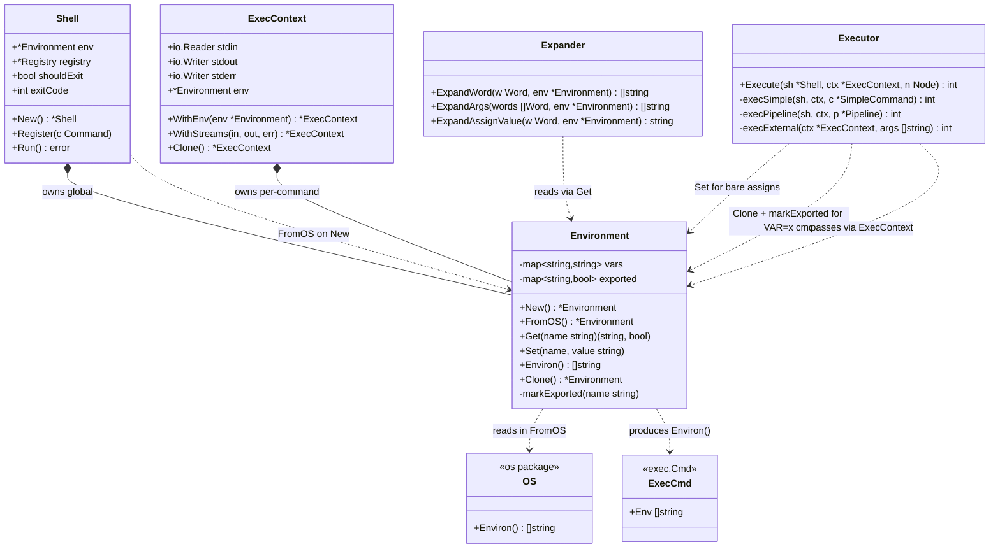

## Environment — финальный вариант (Вариант C)

### Идея

Окружение shell'а — это map «имя → значение» плюс множество имён, помеченных как **экспортированные**. Экспортированные попадают в `exec.Cmd.Env` при запуске внешних процессов, локальные — нет.

Правило простое:

- **всё, что пришло из `os.Environ()`, экспортировано** — `PATH`, `HOME`, `USER` и прочее доступны дочерним процессам;
- **всё, что установлено через `x=1` в shell'е, локально** — не утекает наружу;
- **`VAR=x cmd` работает** — executor клонирует окружение и помечает переменную экспортированной **в клоне**, только для этой команды.

Публичного API для экспорта нет — `export` не поддерживается. Флаг `exported` трогает только `FromOS()` и executor для временных присваиваний.

### Модель

```go
type Environment struct {
    vars     map[string]string
    exported map[string]bool
}
```

Две map, потому что без флага экспортированности нельзя отличить `PATH` (из OS, экспортирован) от `x=1` (локальная).

### API

```go
func New() *Environment
func FromOS() *Environment

func (e *Environment) Get(name string) (string, bool)
func (e *Environment) Set(name, value string)
func (e *Environment) Environ() []string
func (e *Environment) Clone() *Environment

// неэкспортируемый, используется executor'ом
func (e *Environment) markExported(name string)
```

Четыре публичных метода + один приватный. Никаких `Export`, `Unexport`, `IsExported`, `Unset` — их некому вызывать.

### Семантика

**`FromOS()`** — стартовая инициализация:

```go
func FromOS() *Environment {
    env := &Environment{
        vars:     make(map[string]string),
        exported: make(map[string]bool),
    }
    for _, kv := range os.Environ() {
        i := strings.IndexByte(kv, '=')
        if i < 0 {
            continue
        }
        name, value := kv[:i], kv[i+1:]
        env.vars[name] = value
        env.exported[name] = true
    }
    return env
}
```

Всё из `os.Environ()` помечается экспортированным. Так `PATH` работает без явного `export`.

**`Set`** — запись без экспорта:

```go
func (e *Environment) Set(name, value string) {
    e.vars[name] = value
    // exported не трогаем
}
```

**`Get`** — чтение с флагом наличия:

```go
func (e *Environment) Get(name string) (string, bool) {
    v, ok := e.vars[name]
    return v, ok
}
```

Второе значение нужно экспандеру, чтобы в будущем отличить «не установлена» от «установлена в пусто» (`set -u`, `${VAR:-default}`). В минимальной версии оба дают пустую строку.

**`Environ()`** — только экспортированные:

```go
func (e *Environment) Environ() []string {
    out := make([]string, 0, len(e.exported))
    for name := range e.exported {
        if v, ok := e.vars[name]; ok {
            out = append(out, name+"="+v)
        }
    }
    return out
}
```

**`Clone()`** — копия обеих map:

```go
func (e *Environment) Clone() *Environment {
    clone := &Environment{
        vars:     make(map[string]string, len(e.vars)),
        exported: make(map[string]bool, len(e.exported)),
    }
    for k, v := range e.vars {
        clone.vars[k] = v
    }
    for k, v := range e.exported {
        clone.exported[k] = v
    }
    return clone
}
```

**`markExported`** — приватный, для executor'а:

```go
func (e *Environment) markExported(name string) {
    e.exported[name] = true
}
```

### Как это работает в executor'е

**Случай 1: `x=1` отдельной строкой.**

```go
if len(cmd.Args) == 0 {
    for _, a := range cmd.Assigns {
        val := ex.expander.ExpandAssignValue(a.Value)
        sh.env.Set(a.Name, val)   // в глобальное окружение, без экспорта
    }
    return 0
}
```

Переменная видна через `$x`, но не попадёт в `Environ()` → дочерние процессы её не увидят. Ровно поведение Bash без `export`.

**Случай 2: `VAR=x cmd`.**

```go
localEnv := ctx.Env.Clone()
for _, a := range cmd.Assigns {
    val := ex.expander.ExpandAssignValue(a.Value)
    localEnv.Set(a.Name, val)
    localEnv.markExported(a.Name)   // временное присваивание экспортируется
}
// передать localEnv в ExecContext для этой команды
```

Клон с добавленной и помеченной переменной. `cmd` видит `VAR`:

- если `cmd` — builtin, он читает `ctx.Env.Get("VAR")` → находит;
- если `cmd` — внешняя программа, executor передаёт `localEnv.Environ()` в `exec.Cmd.Env` → переменная попадает в дочерний процесс.

Глобальное окружение `sh.env` при этом не меняется.

### Что получается

| Действие     | `$VAR` в shell'е  | Видна дочерним процессам |
| ------------ | ----------------- | ------------------------ |
| `PATH` из OS | да                | да                       |
| `x=1`        | да                | **нет**                  |
| `VAR=x cmd`  | да (внутри `cmd`) | да (для `cmd`)           |

Это ровно поведение Bash без `export`. И при этом `export` не поддерживается — его просто нет в языке shell'а.

### Границы ответственности

**Делает:**

- хранит переменные и флаг экспортированности;
- инициализируется из окружения процесса;
- формирует `Environ()` для внешних процессов;
- поддерживает `Clone` для временных окружений.

**Не делает:**

- не раскрывает `$NAME` (это экспандер);
- не управляет экспортированностью через публичный API — только `FromOS` и executor;
- не знает про AST, парсер, команды.

### Потенциал расширения

Когда понадобится `export` — добавляются публичные методы `Export`/`Unexport`/`IsExported` и builtin `export`. Модель данных уже готова, executor уже умеет помечать переменные экспортированными. Это локальное расширение, не затрагивающее другие слои.

## UML-диаграмма



## Ключевые решения в диаграмме

- **`Environment` — конкретный тип.** Нет нужды в интерфейсе: тесты создают `New()` и работают напрямую.
- **`Shell` владеет глобальным окружением, `ExecContext` — окружением команды.** Обычно это один и тот же указатель, но при `VAR=x cmd` — клон.
- **`Expander` только читает** через `Get`. Чистая функция от `(Word, Environment) → []string`.
- **`Executor` — единственный мутатор.** Он делает `Set` для `x=1`, `Clone` + `markExported` для `VAR=x cmd`. Больше никто окружение не меняет.
- **`markExported` приватный** — доступен только внутри пакета. Пользователь shell'а не может сделать `export`, потому что нет публичного метода.
- **`Environment → OS` и `Environment → ExecCmd`** — две границы с внешним миром: чтение окружения процесса при старте, отдача окружения дочерним процессам при запуске.

## Что дальше

Остался последний слой — `Shell`: REPL-цикл, сборка системы в `New()`, `shouldExit`, `lastStatus`, обработка ошибок лексера и парсера. Плюс можно отдельно разобрать `ExecContext` — там тонкости с `Clone` и `WithStreams` для пайпов. Скажи, что разбираем.
