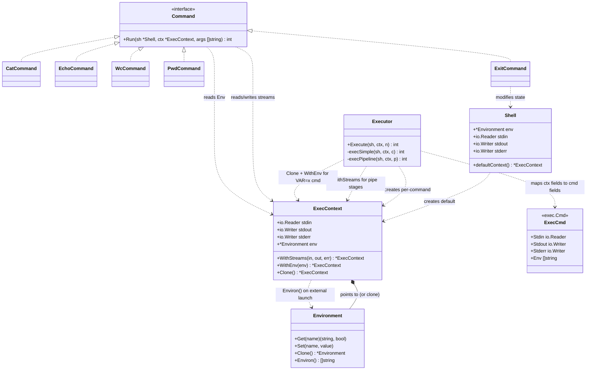

## ExecContext — описание

### Задача

`ExecContext` — это **то, что видит одна команда**: её потоки ввода-вывода и её окружение. Он не хранит глобальное состояние (это `Shell`), не хранит AST (это executor), не хранит реестр (это тоже `Shell`). Только то, что относится к **конкретному исполнению конкретной команды**.

Ключевая идея: команда **никогда** не должна обращаться к `os.Stdout` или `sh.env` напрямую. Она смотрит в `ctx.Stdout` и `ctx.Env`. Это позволяет одной и той же команде работать:

- на терминале — `ctx.Stdout == os.Stdout`;
- в пайпе — `ctx.Stdout == pipeWriter`;
- с редиректом (в будущем) — `ctx.Stdout == file`;
- с временным окружением — `ctx.Env == клон с добавленной переменной`.

Без этой абстракции пайпы и `VAR=x cmd` работали бы только через хаки.

### Модель

```go
type ExecContext struct {
    Stdin  io.Reader
    Stdout io.Writer
    Stderr io.Writer
    Env    *Environment
}
```

Четыре поля — ровно то, что нужно команде, чтобы выполниться. Никаких указателей на `Shell`, никакого `shouldExit`, никакого `lastStatus` — это глобальное, и оно не относится к одной команде.

### Почему `io.Reader`/`io.Writer`, а не `*os.File`

`*os.File` — конкретный тип, привязанный к файловому дескриптору. `io.Reader`/`io.Writer` — интерфейсы, которым удовлетворяют:

- `*os.File` (терминал, файл);
- `*os.Pipe` через `pipe.Reader`/`pipe.Writer` (для пайпов);
- `*bytes.Buffer` (для тестов);
- `io.NopCloser(strings.NewReader(...))` (для тестов).

Использование интерфейсов даёт **тестируемость**: можно запустить команду с буфером вместо терминала и проверить вывод. С `*os.File` пришлось бы создавать временные файлы.

Есть тонкость: `exec.Cmd.Stdout` ожидает `io.Writer`, а `cmd.Stdin` — `io.Reader`. Это ровно те интерфейсы, что в `ExecContext`. Передача тривиальна:

```go
cmd := exec.Command(args[0], args[1:]...)
cmd.Stdin  = ctx.Stdin
cmd.Stdout = ctx.Stdout
cmd.Stderr = ctx.Stderr
```

Go сам разберётся, как подключить их к процессу: если это `*os.File` — напрямую как fd, если нет — через внутреннюю горутину с копированием. Тебе об этом думать не нужно.

### Почему `Env` — указатель на `*Environment`, а не `[]string`

`Environ()` (срез строк) — это **формат для `exec.Cmd.Env`**, а не для команд. Builtin'ам нужен `Get`/`Set`, а не массив строк. Поэтому в `ExecContext` живёт именно `*Environment`, а преобразование в `[]string` делается **только** в момент запуска внешнего процесса:

```go
cmd.Env = ctx.Env.Environ()   // только здесь
```

Если бы в `ExecContext` лежал `[]string`, builtin'ам пришлось бы парсить его обратно в map при каждом чтении переменной. Бессмысленно.

### Методы

```go
func (c *ExecContext) WithStreams(in io.Reader, out, err io.Writer) *ExecContext
func (c *ExecContext) WithEnv(env *Environment) *ExecContext
func (c *ExecContext) Clone() *ExecContext
```

Три метода — это **иммутабельное обновление**. Каждый возвращает **новый** `ExecContext` с изменённым полем, не трогая оригинал. Это нужно, потому что один и тот же базовый контекст используется для нескольких команд в пайпе, но у каждой — свои потоки.

```go
func (c *ExecContext) WithStreams(in io.Reader, out, err io.Writer) *ExecContext {
    return &ExecContext{
        Stdin:  in,
        Stdout: out,
        Stderr: err,
        Env:    c.Env,
    }
}

func (c *ExecContext) WithEnv(env *Environment) *ExecContext {
    return &ExecContext{
        Stdin:  c.Stdin,
        Stdout: c.Stdout,
        Stderr: c.Stderr,
        Env:    env,
    }
}

func (c *ExecContext) Clone() *ExecContext {
    return &ExecContext{
        Stdin:  c.Stdin,
        Stdout: c.Stdout,
        Stderr: c.Stderr,
        Env:    c.Env.Clone(),
    }
}
```

`WithStreams` и `WithEnv` делают **поверхностную** копию — `Env` переиспользуется тот же указатель. `Clone` делает **глубокую** копию окружения — используется в `VAR=x cmd`, чтобы не мутировать глобальное.

### Как это используется в executor'е

**Случай 1: обычная команда на верхнем уровне.**

```go
ctx := sh.defaultContext()   // Stdin=os.Stdin, Stdout=os.Stdout, Env=sh.env
return ex.Execute(sh, ctx, node)
```

**Случай 2: пайплайн.**

```go
func (ex *Executor) execPipeline(sh *Shell, ctx *ExecContext, p *Pipeline) int {
    n := len(p.Commands)
    pipes := make([]*pipePair, n-1)
    for i := range pipes {
        r, w, _ := os.Pipe()
        pipes[i] = &pipePair{r, w}
    }

    status := 0
    for i, cmdNode := range p.Commands {
        cmdCtx := ctx
        if i > 0 {
            cmdCtx = cmdCtx.WithStreams(pipes[i-1].r, cmdCtx.Stdout, cmdCtx.Stderr)
        }
        if i < n-1 {
            cmdCtx = cmdCtx.WithStreams(cmdCtx.Stdin, pipes[i].w, cmdCtx.Stderr)
        }
        status = ex.Execute(sh, cmdCtx, cmdNode)
    }
    // закрыть pipe'ы, дождаться процессов...
    return status
}
```

Каждая команда получает **свой** `ExecContext` через `WithStreams`. Окружение при этом общее — пайплайн не создаёт временных переменных.

**Случай 3: `VAR=x cmd`.**

```go
func (ex *Executor) execSimple(sh *Shell, ctx *ExecContext, c *SimpleCommand) int {
    localEnv := ctx.Env.Clone()   // глубокий клон
    for _, a := range c.Assigns {
        val := ex.expander.ExpandAssignValue(a.Value)
        localEnv.Set(a.Name, val)
        localEnv.markExported(a.Name)
    }
    ctx = ctx.WithEnv(localEnv)   // поверхностный Wrap
    // ... дальше команда видит клон
}
```

Здесь важно: `Clone` делает глубокую копию окружения, но **не** копирует потоки. `WithEnv` создаёт новый `ExecContext` с тем же `Stdin/Stdout`, но с клоном окружения. Это ровно то, что нужно: команда видит новую переменную, но пишет в те же потоки.

### Что живёт в `Shell`, а что в `ExecContext`

| `Shell`                                | `ExecContext`                                |
| -------------------------------------- | -------------------------------------------- |
| `Environment` (глобальное)             | `Env` (обычно тот же указатель, иногда клон) |
| `Registry`                             | —                                            |
| `shouldExit`, `lastStatus`, `exitCode` | —                                            |
| `stdin/stdout/stderr` REPL             | `Stdin/Stdout/Stderr` команды                |

`Shell.stdin` — это то, откуда REPL читает строки. `ctx.Stdin` — то, откуда **команда** читает данные. Это **разные** вещи. `cat` читает из `ctx.Stdin`, а не из `sh.stdin`. В пайпе `ctx.Stdin` — это `pipe.Reader`, а `sh.stdin` по-прежнему терминал.

### Границы ответственности

**ExecContext делает:**

- хранит потоки одной команды;
- хранит окружение одной команды;
- предоставляет иммутабельные методы обновления.

**ExecContext не делает:**

- не знает про `Shell`, `Registry`, AST;
- не создаёт pipe'ы (это executor);
- не запускает процессы;
- не мутирует `Environment` (мутации делает executor над клоном).

### Потенциал расширения

- **Редиректы** — `WithStreams` уже готов принять файл вместо pipe'а. Ничего не меняется.
- **Фоновые процессы (`&`)** — команда получает `ctx` с потоками, отличными от REPL. Никаких изменений в `ExecContext`.
- **Логирование** — можно добавить `Logger *log.Logger` и писать в него из команд. Расширение — новое поле и метод `WithLogger`.
- **Таймауты** — добавить `context.Context` внутрь `ExecContext`. Builtin'ы и внешние процессы смогут его использовать. Локальное расширение.
- **Тестирование** — с `io.Reader`/`io.Writer` легко подставить буферы:
  ```go
  ctx := &ExecContext{
      Stdin:  strings.NewReader("input"),
      Stdout: &bytes.Buffer{},
      Stderr: &bytes.Buffer{},
      Env:    env,
  }
  ```
  Команда работает точно так же, как на терминале.

## UML-диаграмма



## Ключевые решения в диаграмме

- **`ExecContext` содержит `Environment` через композицию (`*--`).** Обычно это тот же указатель, что в `Shell`, но при `VAR=x cmd` — клон. Ключевое: команда **всегда** читает переменные через `ctx.Env`, а не через `sh.Env`.
- **`Shell` создаёт **default**-контекст**, а executor — **дочерние**. Это разделение: shell не знает про пайпы, executor не знает про REPL-цикл.
- **`Executor` вызывает `WithStreams` для каждой стадии пайпа.** Каждая команда получает свой `ExecContext`, но `Env` общий.
- **`Command` читает и пишет через `ExecContext`**, а не через `os.Stdin/Stdout`. Это позволяет одной и той же команде работать в разных контекстах.
- **`ExitCommand` — единственный, кто зависит от `Shell`.** Все остальные работают только через `ctx`.
- **`ExecCmd` — точка перехода к внешним процессам.** Executor копирует `ctx.Stdin/Stdout/Stderr/Env` в `exec.Cmd` — и это единственное место, где `ExecContext` встречается с `os/exec`.

## Что дальше

Все слои разобраны. Могу собрать **финальную сводную диаграмму** всей системы — со всеми компонентами и связями, как итог проектирования. Это удобно вставить в отчёт вместе с текстовым описанием. Скажи, если нужно.
