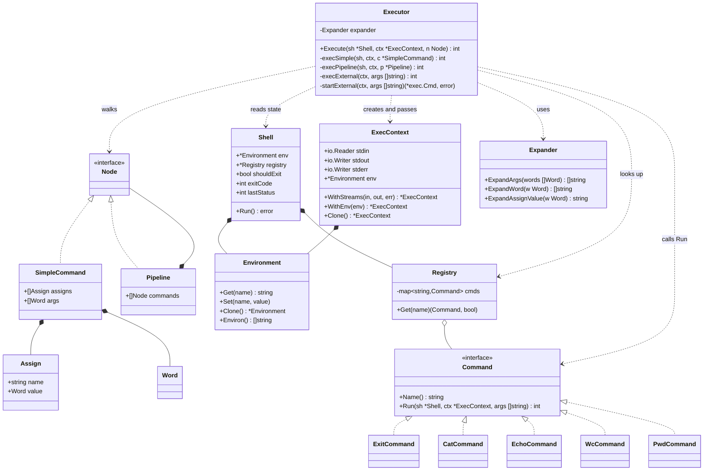

## Executor — описание

### Задача

Executor — **владелец потока управления**. Он обходит AST, вызывает экспандер в нужные моменты, находит команды в реестре, запускает внешние процессы и связывает всё это воедино. Это единственный слой, который знает **порядок** действий: что раскрывать, когда, в каком окружении и что делать с результатом.

Лексер, парсер и экспандер — **чистые функции** от своих входов. Executor — **императивный**: он производит эффекты.

### Что он делает

Для каждого типа узла — своя ветка:

```go
func (ex *Executor) Execute(sh *Shell, ctx *ExecContext, n Node) int {
    switch node := n.(type) {
    case *SimpleCommand:
        return ex.execSimple(sh, ctx, node)
    case *Pipeline:
        return ex.execPipeline(sh, ctx, node)
    }
    return 1
}
```

`Node` — sealed-интерфейс, поэтому `switch` покрывает все случаи, и добавление нового узла — это новый `case` и новая функция.

### `execSimple` — самый содержательный метод

Здесь сходятся вместе присваивания, аргументы, builtin/external и окружение.

```
execSimple(sh, ctx, cmd):
    1. создать localEnv = ctx.Env.Clone()
    2. для каждого присваивания:
         val = expander.ExpandAssignValue(a.Value)   // без split
         localEnv.Set(a.Name, val)
    3. если len(cmd.Args) == 0:
         // только присваивания → записать в постоянное окружение
         для каждого a in cmd.Assigns:
             sh.Env.Set(a.Name, expander.ExpandAssignValue(a.Value))
         return 0
    4. args = expander.ExpandArgs(cmd.Args)          // с split
    5. если len(args) == 0:
         // раскрытие дало пусто (например, $EMPTY вне кавычек)
         // → это «команда без имени», ничего не запускаем
         return 0
    6. name = args[0]
    7. если builtin, ok := registry.Get(name); ok:
         return builtin.Run(sh, ctx.WithEnv(localEnv), args[1:])
    8. иначе:
         return ex.execExternal(ctx.WithEnv(localEnv), args)
```

Три принципиальных момента:

**1. Присваивания видны только своей команде.** `VAR=x cmd` не меняет глобальное окружение — `cmd` получает копию с добавленной переменной. Это делается через `Clone()` и `WithEnv()`. А если команды нет (`VAR=x` отдельной строкой) — присваивание идёт в **глобальное** окружение `sh.Env`.

**2. Присваивания и аргументы раскрываются по-разному.** `ExpandAssignValue` — без split. `ExpandArgs` — с split. Это ровно то, ради чего экспандер сделан сервисом, а не фазой.

**3. Builtin выполняется в том же процессе.** Никакого `fork`. Это критично для `exit` (меняет `sh.shouldExit`), `cd` (меняет `sh.Env["PWD"]`), `export` (меняет `sh.Env`). Внешние команды, наоборот, идут через `exec.Command`.

### Builtin vs external

Реестр знает только про builtin'ы. Если имени там нет — это внешняя команда:

```go
func (ex *Executor) execExternal(ctx *ExecContext, args []string) int {
    cmd := exec.Command(args[0], args[1:]...)
    cmd.Stdin  = ctx.Stdin
    cmd.Stdout = ctx.Stdout
    cmd.Stderr = ctx.Stderr
    cmd.Env    = ctx.Env.Environ()   // []string вида "NAME=value"

    err := cmd.Run()
    if err != nil {
        if exitErr, ok := err.(*exec.ExitError); ok {
            return exitErr.ExitCode()
        }
        fmt.Fprintf(ctx.Stderr, "%s: command not found\n", args[0])
        return 127
    }
    return 0
}
```

`ctx.Stdin/Stdout/Stderr` — это **не** `os.Stdin` напрямую. Это потоки, которые выставляет либо `Shell` (для верхнеуровневой команды — реальные потоки процесса), либо `execPipeline` (для команды в пайпе — концы `os.Pipe()`).

Именно поэтому в `ExecContext` живут `io.Reader`/`io.Writer`, а не `*os.File`. Это абстракция, которая позволяет перенаправлять потоки без изменения кода команд.

### `execPipeline` — где появляются процессы

```
execPipeline(sh, ctx, p):
    n = len(p.Commands)
    pipes = [n-1] * os.Pipe
    processes = []

    для i, cmdNode in p.Commands:
        cmdCtx = ctx.Clone()
        если i > 0:      cmdCtx.Stdin  = pipes[i-1].Reader
        если i < n-1:    cmdCtx.Stdout = pipes[i].Writer

        // запустить i-ю команду
        если cmdNode это *SimpleCommand и это builtin:
            // builtin в пайпе — сложный случай, см. ниже
        иначе:
            p := startExternal(cmdNode, cmdCtx)
            processes.append(p)

        // закрыть концы pipe'а в родителе
        если i > 0:      pipes[i-1].Reader.Close()
        если i < n-1:    pipes[i].Writer.Close()

    // дождаться всех
    status = 0
    для p in processes:
        p.Wait()
        status = p.ExitCode()   // статус последней

    return status
```

**Ключевая тонкость — builtin внутри пайплайна.** Builtin выполняется в том же процессе, но его stdin/stdout должны быть подключены к pipe'ам. Если просто выполнить `EchoCommand.Run(ctx)` с `ctx.Stdout = pipeWriter`, то:

- родительский процесс должен **закрыть** write-конец pipe'а сразу после выполнения builtin'а, иначе читатель на другом конце никогда не увидит EOF;
- иначе получится deadlock: `wc` ждёт EOF на pipe'е, а родитель держит write-конец открытым.

В минимальной версии можно пойти двумя путями:

**Путь A (простой, рекомендуемый):** builtin в пайпе всё равно запускать в отдельном процессе через `exec.Command(os.Args[0], ...)` — то есть форкать сам shell. Это громоздко и требует, чтобы shell умел распознавать «я — дочерний процесс для builtin'а». Для учебного проекта — избыточно.

**Путь B (правильный):** выполнять builtin in-process, но **аккуратно закрывать pipe'ы**:

```go
// после builtin'а закрываем write-конец, который он использовал
if i < n-1 {
    pipes[i].Writer.Close()   // это делает родитель, а не builtin
}
```

При этом `os.Pipe()` нужно создавать **до** запуска всех команд, а закрывать концы — **после** того, как каждая команда получила свой `ExecContext`. Это работает, потому что builtin пишет в pipeWriter синхронно, а внешние процессы читают из pipeReader асинхронно.

Для минимальной версии с `cat`, `echo`, `wc` — путь B работает, потому что все три builtin'а либо читают до EOF, либо пишут и завершаются. Проблемы начнутся с командами, которые **висят** (например, `cat` без аргументов на терминале), но для задачи это не критично.

### Как `exit` меняет состояние

`ExitCommand.Run`:

```go
func (c *ExitCommand) Run(sh *Shell, ctx *ExecContext, args []string) int {
    code := 0
    if len(args) > 0 {
        code, _ = strconv.Atoi(args[0])
    }
    sh.shouldExit = true
    sh.exitCode = code
    return code
}
```

`Shell.Run` проверяет `sh.shouldExit` после каждой строки и завершает цикл. Это единственный способ выйти из REPL без `os.Exit` — важно, чтобы builtin не убивал процесс напрямую, иначе не выполнятся `defer`'ы и не закроются pipe'ы в пайплайне.

### `ExecContext` — что это и зачем

```go
type ExecContext struct {
    Stdin  io.Reader
    Stdout io.Writer
    Stderr io.Writer
    Env    *Environment
}

func (c *ExecContext) WithStreams(in io.Reader, out, err io.Writer) *ExecContext
func (c *ExecContext) WithEnv(env *Environment) *ExecContext
```

`ExecContext` — **то, что видит одна команда**. Он меняется от команды к команде:

- в пайпе у каждой команды свои потоки;
- при `VAR=x cmd` у команды своё окружение;
- при редиректах (в будущем) потоки подменяются на файлы.

`Shell` — **то, что живёт между командами**: глобальное окружение, реестр, флаг выхода, последний статус.

Это разделение — ключ к тому, чтобы пайпы работали: каждая команда получает **свой** `ExecContext` с нужными потоками, но все они видят один и тот же `Shell`.

### Коды возврата

Executor возвращает `int` — статус последней команды. Для `SimpleCommand` это статус builtin'а или внешнего процесса. Для `Pipeline` — статус **последней** команды (в минимальной версии; в Bash есть `pipefail`, но он не требуется).

127 — «command not found» (стандарт POSIX). 126 — «permission denied». 0 — успех.

### Границы ответственности

**Делает:**

- обходит AST;
- вызывает экспандер в нужных точках с нужной политикой;
- различает builtin и external;
- запускает внешние процессы с правильными потоками и окружением;
- связывает команды в пайпе через `os.Pipe()`;
- возвращает код возврата.

**Не делает:**

- не парсит (это парсер);
- не раскрывает переменные (это экспандер);
- не читает ввод (это `Shell.Run`);
- не знает про quoting — он получает уже готовые `[]string`.

### Потенциал расширения

- **`&&`, `||`, `;`** — новые `case` в `Execute`, новая функция `execAndOr`. Не трогает `execSimple`.
- **Редиректы** — `RedirectNode` в AST, `applyRedirs(ctx, redirs)` перед запуском команды. Не трогает логику поиска команды.
- **Фоновые процессы (`&`)** — `execSimple` запускает процесс и не ждёт его; в `Shell` появляется список `jobs`.
- **`$(...)`** — экспандер получает ссылку на executor и вызывает его для подкоманды. Цикла нет, потому что executor владеет обоими.
- **Job control (`Ctrl+Z`, `fg`, `bg`)** — отдельный модуль, работающий с `os.Process` и группами процессов.

## UML-диаграмма



## Что дальше

Осталось два слоя: `Shell` (REPL-цикл и сборка системы) и `Command`/`Registry` (builtin'ы). Плюс можно отдельно пройтись по `Environment` и `ExecContext` — там тоже есть тонкости с `Clone`, `WithLocal` и передачей в `exec.Cmd.Env`. Скажи, что разбираем следующим.
