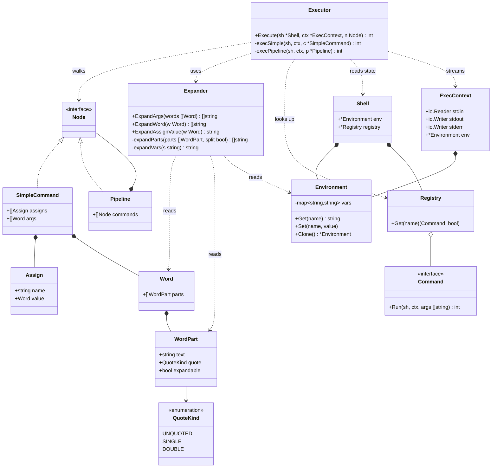

## Expander как сервис — идея

### Что меняется по сравнению с прошлой картинкой

Раньше я рисовал конвейер:

```
Lexer → Parser → Expander → Executor
```

Это создавало ложное впечатление, что экспандер — **фаза** между парсером и executor'ом. На деле это **сервис**, который executor вызывает **по месту** — когда дошёл до конкретного узла AST и ему нужно превратить `Word` в конкретные строки.

Правильная картинка:

```
Lexer → Parser → AST{Word}
                    │
                    ▼
                Executor ──uses──> Expander
                    │
                    ▼
                 effects
```

Executor — единственный, кто владеет потоком управления. Он обходит AST, и в нужный момент вызывает экспандер как функцию.

### Почему это правильнее

**1. Разные политики раскрытия в разных контекстах.** Аргументы команды раскрываются одним способом, значение присваивания — другим, аргументы `for` (в будущем) — третьим. Если экспандер — фаза, ты застрянешь с одной политикой на всё дерево. Если сервис — executor сам решает, **что** и **как** раскрывать в каждой точке.

Пример:

```bash
x=$VAR      # значение присваивания: подстановка БЕЗ split и glob
echo $VAR   # аргумент: подстановка + split + glob
```

Это два **разных** вызова экспандера с разными флагами.

**2. Нет дублирования AST.** В фазовой модели пришлось бы заводить `RawSimpleCommand{Args []Word}` и `ExpandedSimpleCommand{Args []string}` плюс функцию преобразования. В сервисной модели AST один: `SimpleCommand{Args []Word}`, а `[]string` живёт только внутри `execSimple` на время одного вызова.

**3. Совпадает с реальными shell'ами.** В Bash `expand_word` — функция, которую вызывает `execute_command`, а не отдельный проход. Это не случайность, а следствие того, что раскрытие контекстно-зависимо.

**4. Легко расширяется.** Когда появится `$(...)`, экспандеру понадобится вызвать executor для выполнения подкоманды. Если экспандер — фаза, получаем циклическую зависимость `Expander → Executor → Expander`. Если сервис — цикла нет: executor владеет обоими, а экспандер получает executor через параметр.

### Что именно делает экспандер

Три публичных метода — по числу политик раскрытия:

```go
type Expander struct {
    env *Environment
}

// Аргументы команды: подстановка $ + split + glob
// Возвращает список готовых строк-аргументов
func (e *Expander) ExpandArgs(words []Word) []string

// Значение присваивания: подстановка $, но БЕЗ split и glob
// x=$VAR при VAR="a b" даёт "a b" одной строкой, а не два слова
func (e *Expander) ExpandAssignValue(w Word) string

// Одно слово в одном аргументе: подстановка $, split, glob
// Используется, когда нужно раскрыть ровно одно слово
func (e *Expander) ExpandWord(w Word) []string
```

Внутри все три используют общий движок:

```go
// ядро: пройти по сегментам, подставить $, применить split к unquoted
func (e *Expander) expandParts(parts []WordPart, split bool) []string

// подстановка $NAME и ${NAME}
func (e *Expander) expandVars(s string) string

// split по пробелам (в будущем — по IFS)
func splitFields(s string) []string

// globbing (в минимальной версии не нужен)
func glob(fields []string) []string
```

Разница между методами — только в флагах:

| Метод               | expandVars | split   | glob               |
| ------------------- | ---------- | ------- | ------------------ |
| `ExpandArgs`        | да         | да      | да (когда добавим) |
| `ExpandAssignValue` | да         | **нет** | **нет**            |
| `ExpandWord`        | да         | да      | да                 |

### Как это выглядит в executor'е

Executor обходит AST и в нужных местах вызывает экспандер:

```go
func (ex *Executor) execSimple(sh *Shell, ctx *ExecContext, c *SimpleCommand) int {
    // 1. раскрыть присваивания
    localEnv := ctx.Env.Clone()
    for _, a := range c.Assigns {
        val := ex.expander.ExpandAssignValue(a.Value)  // без split
        localEnv.Set(a.Name, val)
    }

    // 2. если команды нет — только присваивания в постоянное окружение
    if len(c.Args) == 0 {
        for _, a := range c.Assigns {
            sh.Env.Set(a.Name, ex.expander.ExpandAssignValue(a.Value))
        }
        return 0
    }

    // 3. раскрыть аргументы команды
    args := ex.expander.ExpandArgs(c.Args)  // с split и glob

    // 4. найти команду: builtin или external
    name := args[0]
    if cmd, ok := ex.registry.Get(name); ok {
        return cmd.Run(sh, ctx.WithEnv(localEnv), args[1:])
    }
    return ex.execExternal(ctx.WithEnv(localEnv), args)
}
```

Обрати внимание: **executor решает, когда и что раскрывать**. Экспандер только предоставляет функции. Это и есть «сервис».

### Где живёт `Environment`

`Environment` — часть `Shell` (глобальное состояние), но раскрытие происходит в контексте конкретной команды. Поэтому:

- `Expander` держит ссылку на **текущее** окружение через `ExecContext`;
- временные присваивания (`VAR=x cmd`) создают `localEnv` через `Clone()`, и он виден только этой команде;
- `Expander` не мутирует окружение — он только читает.

Это разделение важно: экспандер **stateless** относительно окружения, он всегда работает с тем `Environment`, который ему передали.

### Что даёт такая модель

- **Executor — владелец потока управления.** Он один знает порядок: сначала присваивания, потом args, потом поиск команды.
- **Expander — чистая функция.** Принимает `Word` и окружение, возвращает строки. Легко тестируется.
- **AST один.** Никаких пар `Raw`/`Expanded` типов.
- **Расширяемость.** Новый контекст раскрытия = новый метод или новый флаг. Новый синтаксис (`$(...)`, `${VAR:-default}`) = расширение внутри экспандера, не трогая executor.

## UML-диаграмма



## Ключевое отличие от прошлой диаграммы

- `Expander` теперь соединён с `Executor`, а **не** стоит между `Parser` и `Executor`. Он — зависимость, а не звено цепочки.
- `Shell` владеет `Environment` и `Registry`, но **не** владеет `Expander`. Expander создаётся один раз и передаётся в executor (или создаётся внутри `Executor`), потому что он stateless.
- `ExecContext` несёт `Environment` — потому что раскрытие одной команды может видеть временное окружение (`VAR=x cmd`), отличное от глобального.
- `Pipeline` соединён с `Node` — executor рекурсивно обходит дерево, а не только плоский список.

## Что дальше

Следующий слой — **executor**. Там разбираются:

- различие builtin / external;
- как `SimpleCommand` без `Args` (только `Assigns`) превращается в запись переменных;
- как `Pipeline` создаёт `os.Pipe()` и запускает команды с правильными `ExecContext`;
- как `exit` меняет состояние `Shell`.

Если хочешь, разберём его так же — описание + диаграмма, уже с учётом того, что `Expander` — сервис.
