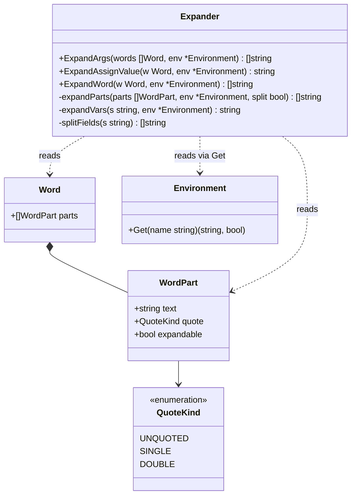

# Expander: место в системе, что делает, как работает

## Почему один класс

Да, весь `Expander` — это **один класс** с тремя публичными методами и парой приватных помощников. Это не случайность и не упрощение — это следствие того, **чем** является экспандер.

Экспандер — **чистая функция** от `(Word, Environment)`. У него нет состояния, которое нужно было бы хранить между вызовами. Он не владеет ресурсами, не создаёт процессов, не пишет в потоки. Он получает данные и возвращает данные. Всё, что нужно для работы, приходит **в аргументах**.

Сравни с другими компонентами:

| Компонент     | Состояние между вызовами                                     | Почему           |
| ------------- | ------------------------------------------------------------ | ---------------- |
| `Lexer`       | `input`, `pos` — но **сбрасывается** на каждый `Tokenize`    | stateless-сервис |
| `Parser`      | `tokens`, `pos` — тоже сбрасывается на каждый `Parse`        | stateless-сервис |
| `Environment` | `vars`, `exported` — **живут** между командами               | stateful         |
| `Shell`       | `env`, `registry`, `shouldExit` — **живут** между итерациями | stateful         |
| `Expander`    | —                                                            | **stateless**    |

Из-за statelessness `Expander` не нужно ни клонировать, ни сериализовать, ни синхронизировать. Один экземпляр на весь shell — и он работает для всех команд.

## Место в системе

Соблазн нарисовать конвейер:

```
Lexer → Parser → Expander → Executor
```

Это **неверно**, потому что создаёт впечатление, что экспандер — **фаза** между парсером и executor'ом. То есть что парсер отдаёт AST экспандеру, тот его полностью раскрывает, а потом отдаёт executor'у уже раскрытый AST.

На деле:

```
Lexer → Parser → AST{Word}
                    │
                    ▼
                Executor ──uses──> Expander
                    │
                    ▼
                 effects
```

**Executor владеет потоком управления.** Он обходит AST, и **в нужный момент** вызывает экспандер — не один раз на всё дерево, а **по месту**, с разными политиками для разных контекстов.

## Почему экспандер — сервис, а не фаза

Четыре причины, каждая из которых ломает фазовую модель.

### Причина 1: разные политики раскрытия

Одна и та же переменная раскрывается **по-разному** в зависимости от контекста:

```bash
VAR="a b c"
x=$VAR          # значение присваивания: → "a b c" одной строкой
echo $VAR       # аргумент команды:    → "a", "b", "c" — три аргумента
echo "$VAR"     # аргумент в кавычках: → "a b c" одним аргументом
```

Если бы экспандер был фазой, он должен был бы **один раз** пройти по дереву и выбрать одну политику для всех `Word`. Но для `x=$VAR` нужна одна политика, для `echo $VAR` — другая. Значит, политика определяется **не экспандером**, а **executor'ом**, который знает, что перед ним: присваивание или аргумент.

### Причина 2: нет дублирования AST

Если бы экспандер был фазой, пришлось бы завести **два набора типов**:

```go
type RawSimpleCommand struct {
    Args []Word      // до раскрытия
}

type ExpandedSimpleCommand struct {
    Args []string    // после раскрытия
}
```

И функцию преобразования `Raw → Expanded`. Это удвоение AST ради того, чтобы разделить две фазы. В сервисной модели AST **один**: `SimpleCommand{Args []Word}`, а `[]string` живёт только внутри `execSimple` на время одного вызова.

### Причина 3: совпадает с реальными shell'ами

В Bash `expand_word` — это **функция**, которую вызывает `execute_command` по месту. Не отдельный проход по дереву. Это не историческая случайность, а следствие того, что раскрытие **контекстно-зависимо**.

### Причина 4: цикл зависимостей при `$(...)`

Когда появится подстановка команд `$(...)`:

```bash
echo "Today is $(date)"
```

Экспандеру нужно **выполнить `date`** и подставить её вывод. Для этого ему нужен **executor**. Если экспандер — фаза, получаем цикл:

```
Expander → Executor → Expander → ...
```

Если сервис — цикла нет: executor владеет обоими, а экспандер получает executor **через параметр** в момент вызова.

## Почему `Word` и `WordPart`

Экспандер получает **не строки**, а `Word` с сегментами — потому что вся информация о кавычках и раскрытии уже закодирована в `WordPart`. Разберём, что экспандер читает из сегментов:

| Поле `WordPart`     | Что решает экспандер                           |
| ------------------- | ---------------------------------------------- |
| `Text`              | что именно подставлять / оставить              |
| `Quote == UNQUOTED` | применять ли к результату split и glob         |
| `Quote == SINGLE`   | **не** подставлять `$`, **не** применять split |
| `Quote == DOUBLE`   | подставлять `$`, но **не** применять split     |
| `Expandable`        | подставлять ли `$` в этом сегменте             |

Без `WordPart` экспандер видел бы только строку `$VAR` и не смог бы отличить:

```
$VAR      → Word{[{$VAR, UNQUOTED, true}]}    → подставить + split
"$VAR"    → Word{[{$VAR, DOUBLE, true}]}      → подставить, без split
'$VAR'    → Word{[{$VAR, SINGLE, false}]}     → не подставлять
```

Три разных результата. Строка `$VAR` одинакова во всех трёх случаях. Сегменты — разные.

## Три политики раскрытия

`Expander` предоставляет **три публичных метода**, по одному на каждую политику:

```go
type Expander struct {
    // нет полей! stateless
}

// Аргументы команды: подстановка $ + split + glob
func (e *Expander) ExpandArgs(words []Word) []string

// Значение присваивания: подстановка $, БЕЗ split и glob
func (e *Expander) ExpandAssignValue(w Word) string

// Одно слово: подстановка $ + split + glob (используется редко)
func (e *Expander) ExpandWord(w Word) []string
```

Разница между методами — **только в флагах**:

| Метод               | `expandVars` | `split` | `glob`             |
| ------------------- | ------------ | ------- | ------------------ |
| `ExpandArgs`        | да           | да      | да (когда добавим) |
| `ExpandAssignValue` | да           | **нет** | **нет**            |
| `ExpandWord`        | да           | да      | да                 |

Внутри все три вызывают общий движок:

```go
func (e *Expander) expandParts(parts []WordPart, env *Environment, split bool) []string
```

## Как работает `expandParts` — пошагово

Это **ядро** экспандера. Разберём его на примере.

### Пример 1: `echo $VAR` где `VAR="a b c"`

**Что приходит от парсера:**

```go
SimpleCommand{
    Args: []Word{
        Word{Parts: []WordPart{{Text: "echo", Quote: UNQUOTED, Expandable: true}}},
        Word{Parts: []WordPart{{Text: "$VAR", Quote: UNQUOTED, Expandable: true}}},
    },
}
```

**Executor вызывает** `ExpandArgs(args)` для всего списка.

Для второго слова (`$VAR`) `expandParts` делает:

**Шаг 1. Идём по сегментам.** Сегмент один: `{Text: "$VAR", Quote: UNQUOTED, Expandable: true}`.

**Шаг 2. `Expandable == true`** → вызываем `expandVars("$VAR", env)`:

- находим `$`, читаем имя `VAR`;
- `env.Get("VAR")` возвращает `"a b c"`;
- результат: `"a b c"`.

**Шаг 3. `Quote == UNQUOTED`** → применяем `splitFields("a b c")`:

- результат: `["a", "b", "c"]`.

**Шаг 4. Склеиваем с накопленным результатом.** Так как это первое (и единственное) слово в этом вызове, `result = ["a", "b", "c"]`.

**Итог:** `echo` получит **три аргумента**: `"a"`, `"b"`, `"c"`.

### Пример 2: `echo "$VAR"` где `VAR="a b c"`

**Что приходит:**

```go
Word{Parts: []WordPart{{Text: "$VAR", Quote: DOUBLE, Expandable: true}}}
```

**Шаги:**

**Шаг 1.** Сегмент `{Text: "$VAR", Quote: DOUBLE, Expandable: true}`.

**Шаг 2. `Expandable == true`** → `expandVars` → `"a b c"`.

**Шаг 3. `Quote == DOUBLE`** → split **не применяем**. Результат: `["a b c"]` — **один аргумент с пробелами внутри**.

**Итог:** `echo` получит **один аргумент**: `"a b c"`.

### Пример 3: `echo '$VAR'`

**Что приходит:**

```go
Word{Parts: []WordPart{{Text: "$VAR", Quote: SINGLE, Expandable: false}}}
```

**Шаги:**

**Шаг 1.** Сегмент `{Text: "$VAR", Quote: SINGLE, Expandable: false}`.

**Шаг 2. `Expandable == false`** → `expandVars` **не вызывается**. Текст остаётся `"$VAR"`.

**Шаг 3. `Quote == SINGLE`** → split не применяем.

**Итог:** `echo` получит **один аргумент**: буквально `"$VAR"`.

### Пример 4: `echo pre$VAR-post` где `VAR="a b"`

**Что приходит:**

```go
Word{Parts: []WordPart{{Text: "pre$VAR-post", Quote: UNQUOTED, Expandable: true}}}
```

**Шаги:**

**Шаг 1.** Один сегмент, `Expandable=true`.

**Шаг 2.** `expandVars("pre$VAR-post")`:

- `pre` остаётся;
- `$VAR` → `"a b"`;
- `-post` остаётся;
- результат: `"prea b-post"`.

**Шаг 3. `UNQUOTED`** → `splitFields("prea b-post")`:

- результат: `["prea", "b-post"]`.

**Итог:** `echo` получит **два аргумента**: `"prea"` и `"b-post"`.

### Пример 5: `echo pre"$VAR"post` где `VAR="a b"`

**Что приходит:**

```go
Word{Parts: []WordPart{
    {Text: "pre", Quote: UNQUOTED, Expandable: true},
    {Text: "$VAR", Quote: DOUBLE, Expandable: true},
    {Text: "post", Quote: UNQUOTED, Expandable: true},
}}
```

**Шаги:**

**Шаг 1.** Идём по сегментам слева направо.

**Шаг 2.** Сегмент `pre`:

- `Expandable=true` → `expandVars("pre")` = `"pre"`;
- `UNQUOTED` → `splitFields("pre")` = `["pre"]`;
- `result = ["pre"]`.

**Шаг 3.** Сегмент `$VAR`:

- `Expandable=true` → `expandVars("$VAR")` = `"a b"`;
- `DOUBLE` → split **не применяем**;
- сегмент **приклеивается к последнему** накопленному полю: `result = ["prea b"]`.

**Шаг 4.** Сегмент `post`:

- `Expandable=true` → `expandVars("post")` = `"post"`;
- `UNQUOTED` → `splitFields("post")` = `["post"]`;
- `post` **приклеивается к последнему**: `result = ["prea bpost"]`.

**Итог:** `echo` получит **один аргумент**: `"prea bpost"`.

Обрати внимание: пробел внутри `$VAR` **не разбил** слово, потому что `$VAR` был в `DOUBLE`-кавычках, а `pre` и `post` приклеились к тому же полю.

## Ключевое правило склейки

Когда сегмент разбился на несколько полей через split:

```
result = ["foo"]            // накоплено от предыдущих сегментов
fields = ["a", "b", "c"]    // пришло от $VAR (UNQUOTED)

→ result = ["fooa", "b", "c"]
```

**Первое поле** приклеивается к последнему накопленному, **остальные** становятся новыми полями. Это воспроизводит поведение Bash:

```bash
VAR="a b c"
echo pre$VAR post
# → prea b c post   (четыре аргумента: prea, b, c, post)
```

А если `VAR` в кавычках:

```bash
echo pre"$VAR" post
# → prea b c post   (три аргумента: "prea b c", "post")
```

Здесь `"$VAR"` не разбивается — целиком приклеивается к `pre` как один сегмент.

## Почему `expandVars` работает на уровне сегмента, а не всего слова

Потому что `Expandable` — свойство **сегмента**, а не слова. В одном слове могут быть сегменты с разным `Expandable`:

```
'$A'$B'$C'  →  три сегмента:
                {Text: "$A", Quote: SINGLE, Expandable: false}   ← не подставляем
                {Text: "$B", Quote: UNQUOTED, Expandable: true}  ← подставляем
                {Text: "$C", Quote: SINGLE, Expandable: false}   ← не подставляем
```

Если бы `expandVars` работал на уровне слова, он бы не знал, где подставлять, а где нет. Поэтому `expandParts` идёт **по сегментам**, и для каждого решает отдельно.

## Почему split применяется к сегменту, а не к слову

Та же причина. В слове `pre"$VAR"post` только сегменты `pre` и `post` — `UNQUOTED`. Split применяется **к ним**, а не ко всему слову `prea bpost`. Если бы split применялся ко всему слову, пробел внутри `$VAR` разбил бы `pre` и `post` на три куска, что неверно.

Правильное поведение: split применяется **только к сегментам с `Quote == UNQUOTED`**, и результат **склеивается** с соседними сегментами по правилу «первое поле приклеивается к последнему накопленному».

## UML-диаграмма Expander

Как ты и предполагал — **один класс** плюс типы, которые он читает.



**Пояснения:**

- **`Expander` — один класс**, без полей. Все данные приходят в аргументах: `Word` (или `[]Word`) и `Environment`. Это делает его stateless и легко тестируемым.
- **`ExpandArgs`** — политика для аргументов команды: подстановка + split + glob.
- **`ExpandAssignValue`** — политика для значения присваивания: подстановка, **без** split и glob.
- **`ExpandWord`** — политика для одного слова: подстановка + split + glob. Используется редко, но нужна для единообразия.
- **`expandParts`** — приватное ядро. Идёт по сегментам, для каждого решает: подставлять ли `$` (по `Expandable`), применять ли split (по `Quote`), склеивать ли с накопленным результатом.
- **`expandVars`** — приватный помощник для подстановки `$NAME` и `${NAME}`.
- **`splitFields`** — приватный помощник для разбиения по пробелам (в будущем — по `IFS`).
- **`Expander` не владеет `Environment`.** Он получает его в аргументах и только читает. Это важно: экспандер не мутирует окружение, он **чистая функция**.

## Итого

**Почему один класс:** экспандер stateless. Все данные приходят в аргументах, ничего не хранится между вызовами. Один экземпляр на весь shell.

**Место в системе:** экспандер — **сервис**, который вызывает `Executor` по месту. Не фаза между парсером и executor'ом. Это позволяет разным контекстам (аргументы, присваивания) использовать разные политики раскрытия.

**Почему `Word` и `WordPart`:** потому что вся информация о кавычках и раскрытии закодирована в сегментах. Без них экспандер не смог бы отличить `$VAR` от `"$VAR"` от `'$VAR'` — три разных результата из одинаковой строки.

**Как работает:** идём по сегментам слова. Для каждого:

- если `Expandable` — подставляем `$`;
- если `UNQUOTED` — применяем split;
- склеиваем с накопленным результатом по правилу «первое поле приклеивается к последнему».

Три публичных метода — три политики: `ExpandArgs` (со split), `ExpandAssignValue` (без split), `ExpandWord` (со split, для одного слова).
