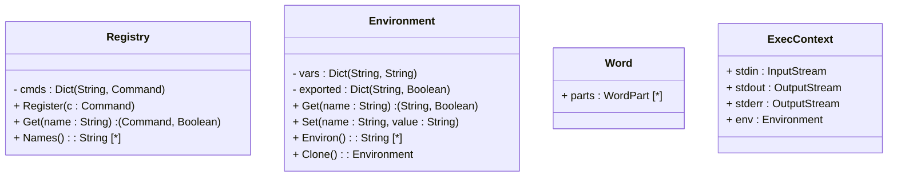

# Instructions.md

## О документе

Этот файл описывает **соглашения**, использованные в проектной документации: в текстовых описаниях, UML-диаграммах и примерах кода. Цель — чтобы любой читатель (в том числе тот, кто не знает Go) понимал, что именно изображено на диаграммах и как это соотносится с реализацией.

## Язык реализации

Проект реализуется на **Go**. Это означает:

- в примерах кода используется синтаксис Go;
- имена типов и методов — в стиле Go (`CamelCase` для экспортируемых, `camelCase` для приватных);
- интерфейсы Go неявные: тип удовлетворяет интерфейсу, если реализует все его методы, без явного `implements`;
- нет наследования — только встраивание и композиция;
- ошибки — это значения, а не исключения.

## UML и Go: различия в нотации

UML — язык моделирования, **независимый от языка реализации**. В нём есть свои соглашения для типов, и они отличаются от Go. Диаграммы в документации следуют UML-нотации, а не Go-синтаксису.

### Типы

| В Go           | В UML                               | Примечание                                        |
| -------------- | ----------------------------------- | ------------------------------------------------- |
| `string`       | `String`                            | В UML `String` — примитив                         |
| `int`, `int64` | `Integer`                           | `UnlimitedNatural` — для неотрицательных          |
| `bool`         | `Boolean`                           |                                                   |
| `float64`      | `Real`                              |                                                   |
| `error`        | `Error` (или стереотип `<<error>>`) | Не стандартный UML-тип, показывается как доменный |
| `io.Reader`    | `InputStream` (или `Reader`)        | UML-way: абстрактный поток ввода                  |
| `io.Writer`    | `OutputStream` (или `Writer`)       | UML-way: абстрактный поток вывода                 |

### Коллекции

В UML **нет синтаксиса `[]`**, как в Go. Вместо этого используется **множественность (multiplicity)** — число в квадратных скобках после типа.

| В Go                               | В UML         | Значение        |
| ---------------------------------- | ------------- | --------------- |
| `[]Word`                           | `Word [*]`    | ноль или больше |
| `[]Word` (гарантированно непустой) | `Word [1..*]` | один или больше |
| `*Word`                            | `Word [0..1]` | ноль или один   |
| `[]Command`                        | `Command [*]` | ноль или больше |

**Порядок записи:** `имя : Тип [множественность]`.

```
+ assigns : Assign [*]
+ args : Word [*]
+ tokens : Token [*]
```

### Map

В Go `map[string]Command` — это ассоциативный массив. В UML прямого типа «map» нет:

Понял, добавляю раздел про словари в формате `Dict(<key>, <value>)` и дополняю остальные места, где это нужно.

## Правка в разделе «Коллекции»

### Словари

В UML прямого типа «map» / «dictionary» нет. В документации используется **явная параметризованная нотация**:

```
Dict(<key>, <value>)
```

Это не стандартный UML, но широко распространённое расширение (встречается в профилях для C++, Java, Python), и оно **читается однозначно**: `Dict(String, Command)` — «словарь, где ключ — строка, значение — команда».

| В Go                 | В UML (в документации)   |
| -------------------- | ------------------------ |
| `map[string]Command` | `Dict(String, Command)`  |
| `map[string]string`  | `Dict(String, String)`   |
| `map[string]bool`    | `Dict(String, Boolean)`  |
| `map[rune]Token`     | `Dict(Character, Token)` |

**Соглашение о ключах.** Ключ в UML-нотации показывается как первый параметр `Dict`. Если ключ — доменный тип (не примитив), он показывается так же: `Dict(Name, Value)`. Если важна уникальность (а в map она всегда есть) — можно добавить пометку `{unique}`, но обычно она подразумевается.

**Альтернатива — ассоциация.** Для диаграмм классов, где `Dict` — часть связи между двумя типами, используется ассоциация с multiplicity:

```
Registry "1" o-- "*" Command : cmds
```

Это UML-way, но для `map[string]Command` он не выражает **ключ** (строку), только значения. Поэтому в диаграммах, где ключ важен, используется `Dict(String, Command)` как поле, а где важен только факт «содержит много команд» — ассоциация.

**Что выбрать в конкретном случае:**

- **Поле внутри класса** — используем `Dict(<key>, <value>)`. Пример: `- cmds : Dict(String, Command)`.
- **Связь между двумя доменными классами** — используем ассоциацию с multiplicity. Пример: `Registry o-- Command`.

## Дополнение в таблицу «Типы»

Добавляю строки про словари и `rune`:

| В Go                | В UML             | Примечание                |
| ------------------- | ----------------- | ------------------------- |
| `map[K]V`           | `Dict(K, V)`      | Параметризованная нотация |
| `rune`              | `Character`       | Unicode-символ            |
| `byte`              | `Byte`            | 8-битное беззнаковое      |
| `any`               | `Any`             | Пустой интерфейс          |
| `struct{}` (пустая) | (не показывается) | Маркер без данных         |

## Дополнение в раздел «Приватные и публичные члены»

Добавляю пример со словарём, чтобы было видно формат в контексте:

```
class Registry {
    - cmds : Dict(String, Command)
    + Register(c : Command)
    + Get(name : String) : (Command, Boolean)
}
```

Здесь `- cmds : Dict(String, Command)` читается так: «приватное поле `cmds`, словарь со строковым ключом и значением-командой». В Go это `cmds map[string]Command`.

## Правка в разделе «Указатели и ссылки»

Добавляю уточнение про то, что `Dict` — значение, а не ссылка:

**Значение vs ссылка.** `Dict(String, Command)` — это тип значения. В Go `map` — ссылочный тип, но в UML это не отражается: `Dict` показывается как обычное поле. Если важно подчеркнуть, что словарь **разделяется** между несколькими владельцами, это показывается через ассоциацию, а не через тип поля.

## Правка в разделе «Что НЕ показывается на диаграммах»

Добавляю пункт про внутреннее устройство map:

**Внутреннее устройство `map`** — хеш-функция, бакеты, load factor — не показывается. Это деталь реализации Go runtime, не имеющая отношения к архитектуре.

**Итерация по map** — порядок не определён в Go, и это не показывается на диаграмме. Если порядок важен (например, для детерминированного вывода), в коде используется сортировка ключей, но на UML это не отражается.

## Итоговая таблица соглашений

Полная сводка по типам и коллекциям:

| Go               | UML            |
| ---------------- | -------------- |
| `string`         | `String`       |
| `int`            | `Integer`      |
| `bool`           | `Boolean`      |
| `float64`        | `Real`         |
| `rune`           | `Character`    |
| `byte`           | `Byte`         |
| `error`          | `Error`        |
| `any`            | `Any`          |
| `[]T`            | `T [*]`        |
| `[]T` (непустой) | `T [1..*]`     |
| `*T`             | `T [0..1]`     |
| `map[K]V`        | `Dict(K, V)`   |
| `io.Reader`      | `InputStream`  |
| `io.Writer`      | `OutputStream` |

## Пример: как это выглядит на диаграмме



Здесь видно всё вместе:

- `Dict(String, Command)` — словарь команд по имени;
- `Dict(String, String)` — переменные окружения;
- `Dict(String, Boolean)` — флаги экспортированности;
- `WordPart [*]` — список сегментов слова;
- `String [*]` — список строк;
- `InputStream` / `OutputStream` — абстрактные потоки.

Читается без знания Go.

### Указатели и ссылки

UML не различает «значение» и «указатель» — это деталь реализации языка. В диаграммах:

- **композиция** (`*--`) — «владеет, часть целого»;
- **агрегация** (`o--`) — «содержит, но не владеет»;
- **ассоциация** (`-->`) — «знает о, использует»;
- **зависимость** (`..>`) — «использует временно».

В Go это соответствует:

- композиция — поле-значение или поле-указатель, где владелец управляет жизненным циклом;
- агрегация — поле-указатель на разделяемый объект;
- зависимость — параметр метода или локальная переменная.

### Интерфейсы

В Go интерфейс — это набор методов. В UML интерфейс показывается стереотипом `<<interface>>` и списком методов без реализации. Это совпадает.

Отличие: в Go **нет явного `implements`**. На UML-диаграмме связь «реализует» (`<|..`) показывает, что тип удовлетворяет интерфейсу, но в коде это неявно.

### Приватные и публичные члены

В UML:

- `+` — публичный (public);
- `-` — приватный (private);
- `#` — защищённый (protected);
- `~` — пакетный (package-private).

В Go:

- экспортируемые имена — с заглавной буквы (публичные);
- неэкспортируемые — со строчной (приватные на уровне пакета);
- защищённых и package-private в UML-смысле в Go нет.

Соответствие в диаграммах:

- `+` ↔ имя с заглавной буквы;
- `-` ↔ имя со строчной буквы.

### Методы, возвращающие несколько значений

В Go метод может вернуть несколько значений:

```go
func (e *Environment) Get(name string) (string, bool)
```

В UML метод имеет **один** возвращаемый тип. Для таких случаев используется:

- **кортеж**: `+ Get(name: String) : (String, Boolean)`;
- или **отдельный тип**: `+ Get(name: String) : LookupResult`, где `LookupResult` — структура с полями.

В наших диаграммах используется **кортеж** — это компромисс, понятный читателю Go.

### Ошибки

В Go нет исключений. Метод, который может провалиться, возвращает `error` последним значением:

```go
func (l *Lexer) Tokenize(input string) ([]Token, error)
```

В UML:

- `+ Tokenize(input: String) : (Token [*], Error)`;
- или стереотип `<<throws>>` на операции, но это не соответствует Go-семантике;
- или отдельный тип-результат.

В наших диаграммах используется **кортеж с `Error`**.

## Соглашения по именованию

**Типы** — в `CamelCase` с заглавной буквы: `Environment`, `Registry`, `SimpleCommand`.

**Методы и поля** — в `camelCase` со строчной для приватных: `registerDefaults`, `shouldExit`.

**Интерфейсы** — без префикса `I`. В Go идиоматично `Command`, а не `ICommand`. Исключение — интерфейсы с одним методом, часто называются по методу с суффиксом `-er`: `Reader`, `Writer`.

**Пакеты** — короткие, в нижнем регистре, без подчёркиваний: `command`, `builtins`, `lexer`.

## Обозначения на диаграммах

### Стрелки и линии

| Нотация | Значение                                                          |
| ------- | ----------------------------------------------------------------- |
| `*--`   | Композиция: владелец управляет жизненным циклом                   |
| `o--`   | Агрегация: содержит, но не владеет                                |
| `-->`   | Ассоциация: знает о, использует                                   |
| `..>`   | Зависимость: использует временно (параметр, локальная переменная) |
| `<\|--` | Наследование (в Go — встраивание)                                 |
| `<\|..` | Реализация интерфейса (в Go — неявная)                            |

### Стереотипы

| Стереотип         | Значение                                       |
| ----------------- | ---------------------------------------------- |
| `<<interface>>`   | Интерфейс Go                                   |
| `<<enumeration>>` | Перечисление (в Go — `const` с `iota`)         |
| `<<package>>`     | Пакет Go                                       |
| `<<external>>`    | Тип, реализуемый пользователем системы         |
| `<<error>>`       | Тип ошибки                                     |
| `<<sealed>>`      | Интерфейс с неэкспортируемым маркерным методом |

## Соглашения по коду в примерах

**Фрагменты кода** — на Go, с реальным синтаксисом. Они показывают **идею**, а не полную реализацию. Пропуски обозначаются `// ...`.

**Обработка ошибок** в примерах часто опускается для краткости. В реальном коде Go-идиоматика требует явной проверки каждого `err`.

**Псевдокод** используется там, где важна логика, а не синтаксис. Он записывается в отступах, без подсветки как Go. Пример:

```
execSimple(sh, ctx, cmd):
    localEnv = ctx.Env.Clone()
    for each assign in cmd.Assigns:
        localEnv.Set(...)
```

**Примеры использования** — это то, что видит пользователь shell'а:

```
> echo "Hello, world!"
Hello, world!
```

Префикс `>` — приглашение shell'а. Ответ системы — без префикса.

## Что НЕ показывается на диаграммах

**Детали реализации Go**, не имеющие аналога в UML:

- конкретные типы `io.Reader` / `io.Writer` (показываются как `InputStream` / `OutputStream`);
- указатели vs значения (показывается через тип связи);
- `nil` (не показывается);
- `defer` (не показывается — это control flow, а не структура);
- горутины (показываются только если это архитектурно важно);
- встраивание структур (в UML — композиция или ассоциация, в зависимости от смысла).

**Глобальные переменные** — в проекте их нет. Если где-то используется пакетная переменная, она показывается как элемент пакета (`<<package>>`).

**Пакеты команд** — на диаграммах показываются как единый слой `builtins`, а не как отдельные пакеты для каждой команды. Детализация по пакетам — это implementation detail.

## Соглашения по документации

**Каждый слой описывается по шаблону:**

1. Задача — что слой делает.
2. Модель — какие типы он создаёт и использует.
3. API — публичные методы.
4. Семантика — как методы работают и почему именно так.
5. Границы ответственности — что слой **делает**, и что **не делает**.
6. Потенциал расширения — что можно добавить без переделки.
7. UML-диаграмма — визуальная схема слоя.

**Термины** используются в их shell-значении, а не в общебытовом:

- «раскрытие» — expansion (`$VAR`, globbing, split);
- «слово» — shell-слово (`Word`), а не строка;
- «команда» — либо builtin, либо external;
- «окружение» — `Environment`, а не «среда выполнения».

**Примеры** приводятся для каждого нетривиального случая. Если поведение может быть неочевидным (`VAR=x cmd`, `"$VAR"` vs `$VAR`) — пример обязателен.

## Версионирование документа

Документация и код развиваются вместе. Изменения в архитектуре сначала отражаются в описаниях и диаграммах, потом в коде. Диаграмма, которая не соответствует коду, считается багом документации.

## Обратная связь

Если при чтении документации возникает вопрос «почему так, а не иначе» — это сигнал, что в описании не хватает **обоснования**. Каждое архитектурное решение должно быть объяснено: что рассматривалось как альтернатива, почему выбран именно этот вариант.
