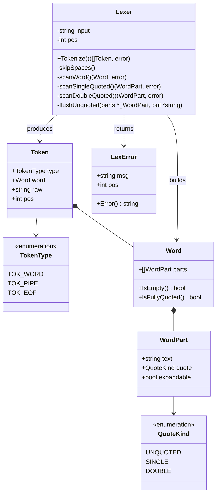

---

## Лексер — обновлённое описание

### Задача

Превратить строку ввода в плоский список токенов, сохранив информацию о кавычках и экранировании. Лексер занимается **только лексикой**: классифицирует символы, снимает кавычки, помечает сегменты. Он **не знает** ни про присваивания, ни про окружение, ни про пайпы как исполнение.

### Модель данных

Токен-слово несёт не строку, а `Word` из сегментов. Каждый сегмент знает свой вид кавычек и разрешено ли внутри раскрытие `$`:

```go
type QuoteKind int

const (
    UNQUOTED QuoteKind = iota
    SINGLE      // '...'
    DOUBLE      // "..."
)

type WordPart struct {
    Text       string
    Quote      QuoteKind
    Expandable bool
}

type Word struct {
    Parts []WordPart
}

type Token struct {
    Type TokenType
    Word Word
    Raw  string
    Pos  int
}

type TokenType int

const (
    TOK_WORD TokenType = iota
    TOK_PIPE
    TOK_EOF
)
```

### Правила сегментации

| Контекст    | `Quote`    | `Expandable` |
| ----------- | ---------- | ------------ |
| вне кавычек | `UNQUOTED` | `true`       |
| `'...'`     | `SINGLE`   | `false`      |
| `"..."`     | `DOUBLE`   | `true`       |

### Алгоритм

`scanWord` накапливает текст вне кавычек в буфер, а на границе кавычек сбрасывает буфер как `UNQUOTED`-сегмент и добавляет сегмент, целиком построенный соответствующим сканером:

```
scanWord():
    parts = []
    buf = ""
    while pos < len(input):
        c = input[pos]
        if c in {' ', '\t', '|', '\0'}: break
        if c == '\'':
            flushUnquoted(&parts, &buf)
            parts.append(scanSingleQuoted())   // SINGLE, expandable=false
            continue
        if c == '"':
            flushUnquoted(&parts, &buf)
            parts.append(scanDoubleQuoted())   // DOUBLE, expandable=true
            continue
        if c == '\\':
            buf += input[pos+1]; pos += 2; continue
        buf += c; pos++
    flushUnquoted(&parts, &buf)
    return Word{Parts: parts}
```

`flushUnquoted` добавляет сегмент только если буфер непустой — иначе пустые сегменты засоряли бы `Word`.

```

```
