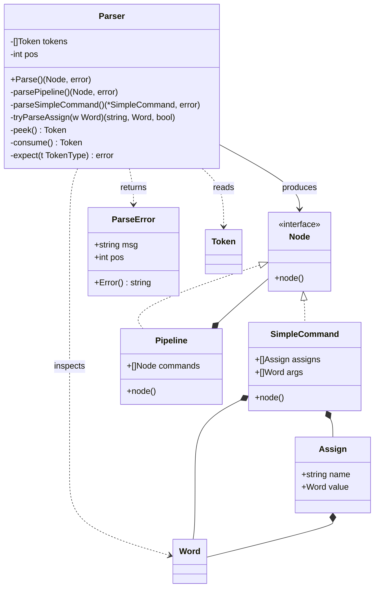

## Парсер — обновлённое описание

### Задача

Превратить плоский список токенов в **AST** — дерево, однозначно описывающее, что нужно исполнить. Парсер работает **после лексера** и **до экспандера**: он не раскрывает переменные и не знает про окружение. Его единственная работа — построить структуру по грамматике.

### Грамматика

```
pipeline      := simpleCommand ( '|' simpleCommand )*
simpleCommand := assignment* word*
assignment    := WORD, если оно имеет форму NAME=value
```

Читается так: пайплайн — это одна или несколько простых команд, соединённых `|`. Простая команда — это последовательность присваиваний в начале, за которой идут слова (команда и её аргументы). Присваивания всегда идут **перед** словами; как только встретилось первое не-присваивание, все остальные слова — аргументы.

### AST

```go
type Node interface {
    node()   // sealed marker
}

type SimpleCommand struct {
    Assigns []Assign
    Args    []Word
}

func (*SimpleCommand) node() {}

type Pipeline struct {
    Commands []Node
}

func (*Pipeline) node() {}

type Assign struct {
    Name  string
    Value Word
}
```

`Args` — это `[]Word`, а не `[]string`, потому что на этапе парсинга значения переменных ещё неизвестны. `Assign.Value` — тоже `Word`: `x=$VAR` раскроется только в экспандере.

### Разделение ответственности с лексером

Лексер выдаёт три типа токенов: `TOK_WORD`, `TOK_PIPE`, `TOK_EOF`. Парсер сам решает, что из слова `x=1` нужно построить `Assign`, а из `echo` — аргумент, и решает это **по позиции в команде**.

### Алгоритм: рекурсивный спуск

Парсер — классический recursive descent с одним указателем по токенам.

```
Parse():
    if peek() == EOF: return nil
    node = parsePipeline()
    expect(EOF)
    return node

parsePipeline():
    left = parseSimpleCommand()
    while peek().Type == TOK_PIPE:
        consume(PIPE)
        right = parseSimpleCommand()
        if left is *Pipeline:
            left.Commands = append(left.Commands, right)
        else:
            left = &Pipeline{Commands: []Node{left, right}}
    return left

parseSimpleCommand():
    cmd = &SimpleCommand{}
    for peek().Type == TOK_WORD:
        if name, value, ok := tryParseAssign(peek().Word); ok:
            cmd.Assigns = append(cmd.Assigns, Assign{name, value})
            consume()
            continue
        break
    for peek().Type == TOK_WORD:
        cmd.Args = append(cmd.Args, consume().Word)
    return cmd
```

**Пайплайн — плоский список, а не бинарное дерево.** Семантически `a | b | c` — это список из трёх команд, а не `(a | b) | c`. Плоская структура упрощает executor (цикл вместо рекурсии) и позволяет позже добавить `|&` как флаг на конкретной команде.

**Присваивания читаются только в фазе 1.** Как только встретилось слово, не являющееся присваиванием, — выход из фазы 1, и дальше всё читается как аргументы, даже если слово выглядит как `NAME=value`.

### `tryParseAssign` — сердце парсера

Функция пытается разобрать `Word` как `NAME=value`:

```go
func tryParseAssign(w Word) (name string, value Word, ok bool)
```

Правила:

1. **Первый сегмент должен быть `UNQUOTED` и `Expandable`.** Это отсекает `"x=y"` — внутри кавычек `=` не считается разделителем присваивания.
2. **В тексте первого сегмента должен быть `=`.** Часть до `=` — имя, часть после — начало значения.
3. **Имя должно быть валидным идентификатором:** `[A-Za-z_][A-Za-z0-9_]*`. Это отсекает `1x=1` и `=foo`.
4. **Значение — это `Word`**, склеенный из «хвоста» первого сегмента и всех последующих сегментов.

Разберём случаи:

| Вход      | Сегменты после лексера               | Результат                               |
| --------- | ------------------------------------ | --------------------------------------- |
| `x=1`     | `[{x=1, UNQUOTED}]`                  | `Name=x, Value={1}`                     |
| `x=`      | `[{x=, UNQUOTED}]`                   | `Name=x, Value=пусто`                   |
| `x=$VAR`  | `[{x=, UNQUOTED}, {$VAR, UNQUOTED}]` | `Name=x, Value={$VAR}`                  |
| `x="a b"` | `[{x=, UNQUOTED}, {a b, DOUBLE}]`    | `Name=x, Value={"a b"}`                 |
| `"x=y"`   | `[{x=y, DOUBLE}]`                    | не присваивание (первый сегмент quoted) |
| `1x=1`    | `[{1x=1, UNQUOTED}]`                 | не присваивание (имя невалидно)         |
| `echo`    | `[{echo, UNQUOTED}]`                 | не присваивание (нет `=`)               |

### Ошибки

В минимальной грамматике их мало:

```go
type ParseError struct {
    Msg string
    Pos int
}
```

Возможные случаи:

- `| cat` — пайплайн не может начинаться с `|`;
- `cat |` — после `|` ожидалась команда;
- `cat || wc` — два `PIPE` подряд.

## UML-диаграмма парсера


