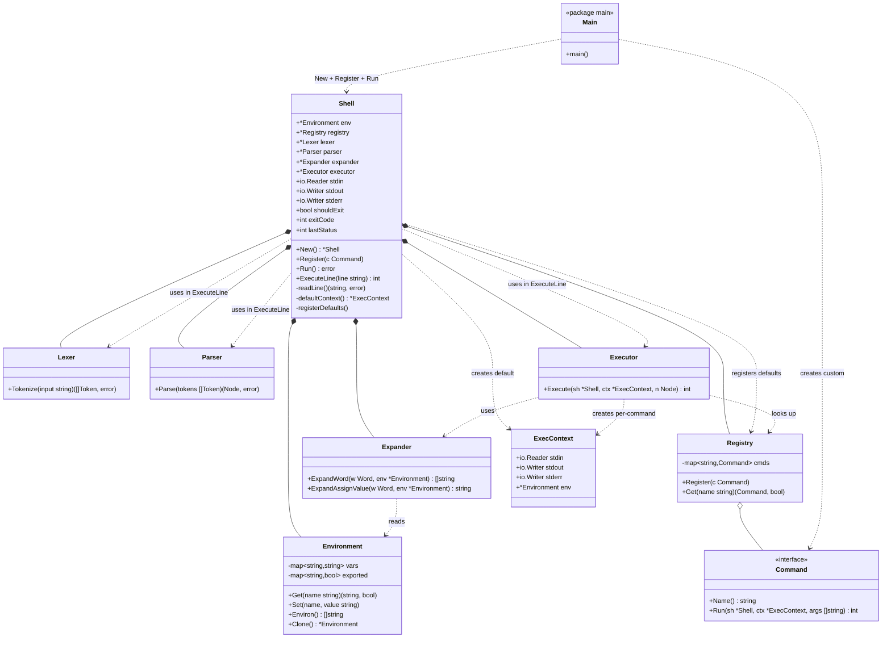

## Shell и REPL — описание

### Задача

`Shell` — это **фасад системы и владелец REPL-цикла**. Он делает три вещи:

1. **Собирает систему** в конструкторе `New()`: создаёт `Environment`, `Registry`, регистрирует стандартные команды, создаёт лексер, парсер, экспандер, executor.
2. **Крутит REPL**: читает строки, передаёт их в конвейер обработки, повторяет до выхода.
3. **Хранит состояние между итерациями**: окружение, реестр команд, флаг выхода, последний код возврата.

Это единственное место, которое знает обо всех слоях сразу. Остальные компоненты (лексер, парсер, экспандер, executor) — stateless-сервисы, которые `Shell` вызывает, но которые не знают друг о друге.

### Что такое REPL

REPL — акроним от **Read-Eval-Print Loop**. Это схема работы любого интерактивного интерпретатора: shell'а, Python, Node.js, psql.

```
┌──────────────────────────────────────────┐
│                                          │
│   Read   ──▶  прочитать строку ввода     │
│     │                                    │
│     ▼                                    │
│   Eval   ──▶  выполнить её               │
│     │                                    │
│     ▼                                    │
│   Print  ──▶  напечатать результат       │
│     │                                    │
│     ▼                                    │
│   Loop   ──▶  вернуться к Read           │
│                                          │
└──────────────────────────────────────────┘
```

Цикл крутится до явного выхода: `exit`, Ctrl+D, EOF.

### Четыре фазы в контексте shell'а

**Read — прочитать строку.** Включает:

- вывод приглашения (`myshell> `);
- чтение строки до newline;
- обработку Ctrl+D (EOF → выход из shell'а).

**Eval — выполнить строку.** Это конвейер из трёх стадий:

- `Lexer.Tokenize(line)` → `[]Token`;
- `Parser.Parse(tokens)` → `Node` (AST);
- `Executor.Execute(sh, ctx, node)` → эффекты.

**Print — напечатать результат.** В shell'е этой фазы **почти нет**: команды сами пишут в `ctx.Stdout`. Единственное, что печатает shell, — сообщения об ошибках лексера/парсера в `stderr`.

**Loop — вернуться к началу.** Проверить `sh.shouldExit`. Если выставлен — завершить цикл. Иначе — снова Read.

### Что живёт между итерациями и что внутри

Ключевое разделение, которое делает REPL возможным:

| Между итерациями (состояние `Shell`) | Внутри одной итерации |
| ------------------------------------ | --------------------- |
| `Environment` — переменные           | `[]Token`             |
| `Registry` — команды                 | `Node` (AST)          |
| `shouldExit`, `lastStatus`           | `ExecContext`         |
| `stdin/stdout/stderr` (для REPL)     | временные буферы      |

Именно поэтому `x=1` в одной строке виден в следующей: `Environment` переживает итерацию. А `Token[]` и `AST` — нет, они создаются заново.

### `Shell.Run()` — цикл

```go
func (sh *Shell) Run() error {
    for !sh.shouldExit {
        line, err := sh.readLine()
        if err == io.EOF {
            return nil
        }
        if err != nil {
            fmt.Fprintln(sh.stderr, err)
            continue
        }

        sh.lastStatus = sh.ExecuteLine(line)
    }
    return nil
}
```

Четыре момента:

**Условие `!sh.shouldExit`.** Флаг выставляет `ExitCommand.Run`. Это единственный способ выйти из REPL **без** `os.Exit` — важно, чтобы не пропустить `defer`'ы и корректно закрыть ресурсы.

**`readLine()` может вернуть `io.EOF`** — это Ctrl+D. Тогда выходим из цикла без ошибки.

**Ошибки чтения не завершают shell.** Печатаем в stderr и продолжаем цикл. Это REPL: одна плохая строка не должна убивать сессию.

**`lastStatus` сохраняется** — пригодится в будущем для `$?`.

### `Shell.ExecuteLine()` — Eval

```go
func (sh *Shell) ExecuteLine(line string) int {
    tokens, err := sh.lexer.Tokenize(line)
    if err != nil {
        fmt.Fprintf(sh.stderr, "lex: %v\n", err)
        return 1
    }

    node, err := sh.parser.Parse(tokens)
    if err != nil {
        fmt.Fprintf(sh.stderr, "parse: %v\n", err)
        return 1
    }
    if node == nil {
        return 0   // пустая строка
    }

    ctx := sh.defaultContext()
    return sh.executor.Execute(sh, ctx, node)
}
```

Три стадии конвейера, каждая может вернуть ошибку — и все они обрабатываются **здесь**, в одном месте:

- **ошибки лексера** — незакрытые кавычки и т.п.;
- **ошибки парсера** — `| cat`, `cat |` и т.п.;
- **пустой ввод** — `node == nil` → ничего не делаем, возвращаем 0.

Ошибки **не бросают исключения и не завершают shell** — они печатаются в `stderr`, и `ExecuteLine` возвращает код возврата. Это соответствует семантике shell'а: `$?` — часть языка, а не исключительная ситуация.

### `defaultContext()` — потоки для REPL

```go
func (sh *Shell) defaultContext() *ExecContext {
    return &ExecContext{
        Stdin:  sh.stdin,
        Stdout: sh.stdout,
        Stderr: sh.stderr,
        Env:    sh.env,
    }
}
```

Для верхнеуровневой команды `ExecContext` указывает на реальные потоки процесса (или на те, что заданы при создании shell'а). При пайплайне executor создаёт **дочерние** `ExecContext` с pipe'ами — это его забота, не shell'а.

`Env` указывает на **глобальное** окружение. Для `VAR=x cmd` executor создаст клон, но это тоже его работа.

### `Shell.New()` — сборка системы

```go
func New() *Shell {
    sh := &Shell{
        env:      Environment.FromOS(),
        registry: command.NewRegistry(),
        lexer:    lexer.New(),
        parser:   parser.New(),
        expander: expander.New(),
        stdin:    os.Stdin,
        stdout:   os.Stdout,
        stderr:   os.Stderr,
    }

    sh.executor = executor.New(sh.expander)
    sh.registerDefaults()
    return sh
}

func (sh *Shell) registerDefaults() {
    sh.registry.Register(&builtins.CatCommand{})
    sh.registry.Register(&builtins.EchoCommand{})
    sh.registry.Register(&builtins.WcCommand{})
    sh.registry.Register(&builtins.PwdCommand{})
    sh.registry.Register(&builtins.ExitCommand{})
}
```

Здесь собирается вся система:

- `Environment.FromOS()` — стартовое окружение из `os.Environ()`;
- `Registry` — пустой, наполняется в `registerDefaults`;
- `Lexer`, `Parser`, `Expander` — stateless-сервисы, создаются один раз;
- `Executor` — получает ссылку на экспандер;
- `stdin/stdout/stderr` — по умолчанию реальные потоки процесса.

`New()` — единственное место, где все слои встречаются. Если что-то не сходится по зависимостям — видно здесь.

### `Shell.Register()` — точка расширения

```go
func (sh *Shell) Register(c command.Command) {
    sh.registry.Register(c)
}
```

Один метод. Пользователь вызывает `sh.Register(&MyCommand{})` в `main.go` — и команда доступна. Если имя совпадает со стандартным — перекрывает его.

### `Shell` vs `ExecContext` — разделение состояния

Важно понимать, что **принадлежит shell'у**, а что — **конкретной команде**:

| `Shell` (между командами)            | `ExecContext` (внутри команды)                                        |
| ------------------------------------ | --------------------------------------------------------------------- |
| `Environment` — глобальное окружение | `Env` — обычно тот же указатель, иногда клон                          |
| `Registry` — все команды             | —                                                                     |
| `shouldExit`, `lastStatus`           | —                                                                     |
| `stdin/stdout/stderr` — потоки REPL  | `Stdin/Stdout/Stderr` — потоки **этой** команды (могут быть pipe'ами) |

Это разделение — ключ к пайпам: `cat f | wc` запускает **две** команды, у каждой **свой** `ExecContext` (с разными потоками), но **общий** `Shell` (с общим окружением и реестром).

### Границы ответственности

**Shell делает:**

- собирает систему в `New()`;
- крутит REPL в `Run()`;
- обрабатывает ошибки лексера/парсера в `ExecuteLine()`;
- хранит глобальное состояние между итерациями;
- предоставляет `Register` для пользовательских команд.

**Shell не делает:**

- не парсит, не раскрывает переменные, не исполняет команды;
- не создаёт pipe'ы (это executor);
- не управляет экспортом переменных (это executor);
- не решает, что делать с `VAR=x cmd` (это executor).

### Потенциал расширения

- **История команд** — добавить `history []string` в `Shell` и записывать каждую строку в `Run()`.
- **Автодополнение** — заменить `readLine()` на вызов `readline`-библиотеки, которая умеет Tab. Ядро REPL не меняется.
- **Неинтерактивный режим** — `Shell.RunScript(file)` читает строки из файла вместо stdin. `ExecuteLine` тот же.
- **`$?`** — `lastStatus` уже есть, остаётся только добавить его в `Environment` перед каждой командой.
- **Конфиг-файл** (`.myshellrc`) — `New()` читает файл и выполняет строки через `ExecuteLine` до запуска REPL.

## UML-диаграмма



## Ключевые решения в диаграмме

- **`Shell` владеет всеми компонентами через композицию (`*--`).** Он — единственное место, где они встречаются. Если удалить `Shell`, система рассыпется на независимые сервисы.
- **`Shell` использует лексер, парсер и executor в `ExecuteLine`.** Эти связи показаны как `..>` (зависимость), а не композиция: сервисы могли бы существовать и без shell'а.
- **`Executor` создаёт `ExecContext` per-command.** Shell создаёт только **default**-контекст для верхнеуровневой команды. Для пайпов executor плодит дочерние контексты.
- **`Main` — единственная точка, где создаётся `Shell`.** Пользовательские команды регистрируются здесь же, через `Shell.Register`.
- **`Command` — интерфейс, `Registry` — его контейнер.** Это позволяет добавлять команды без изменения shell'а.

## Что дальше

Остался последний компонент — `ExecContext`. Там тонкости с `Clone`, `WithStreams`, `WithEnv` и тем, как потоки передаются в `exec.Cmd` при пайпах. Это маленький, но важный тип — без него не заработают ни пайпы, ни `VAR=x cmd`. Скажи, если разбираем.
